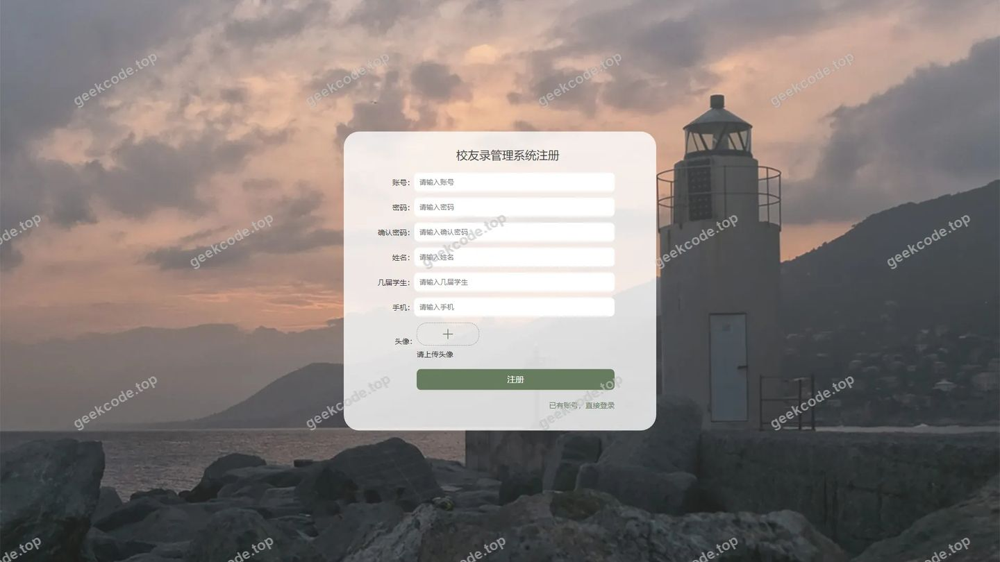
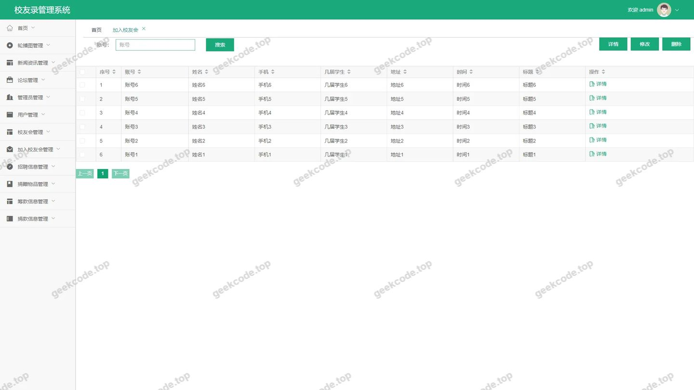
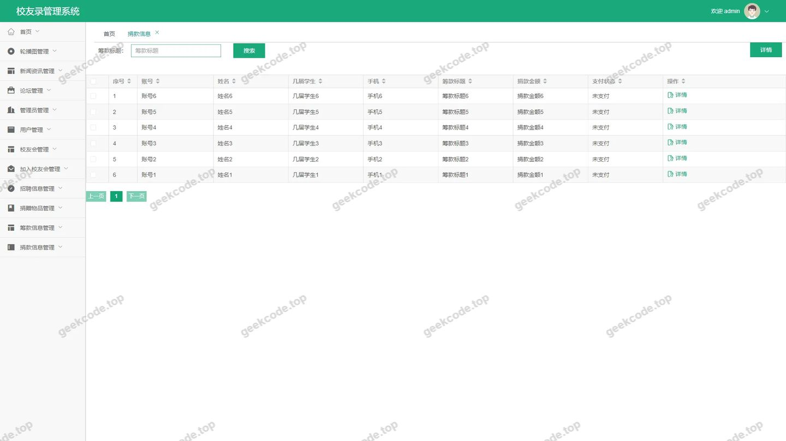
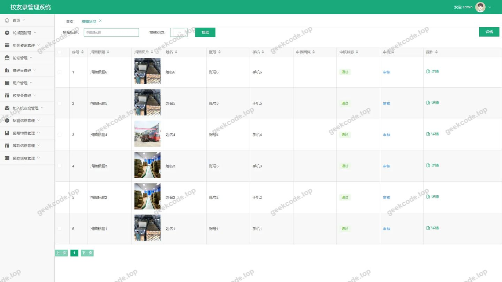
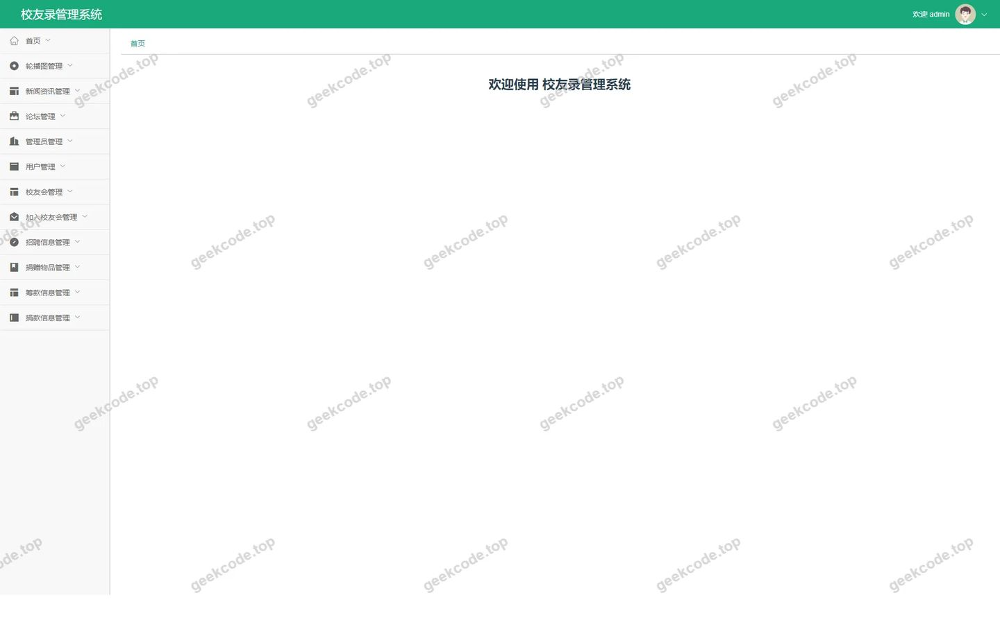
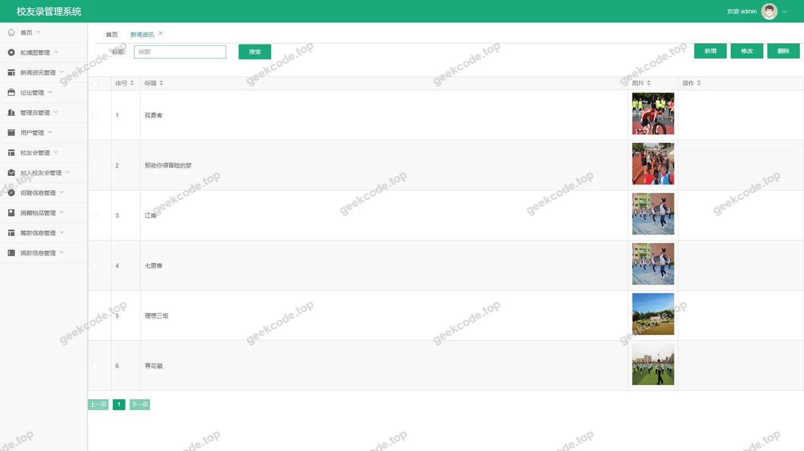
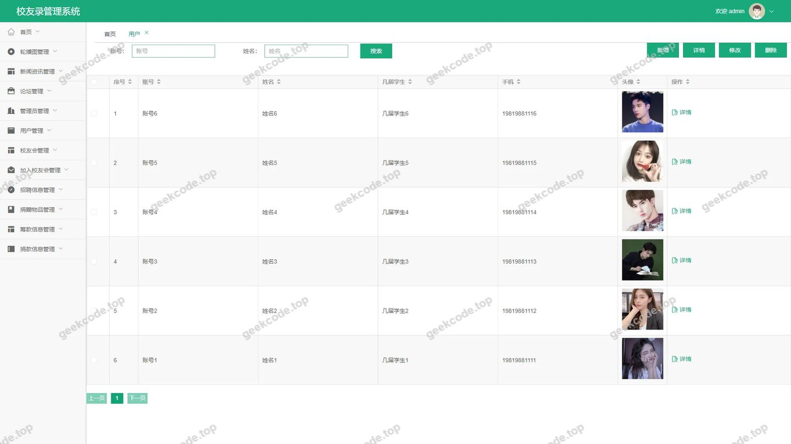
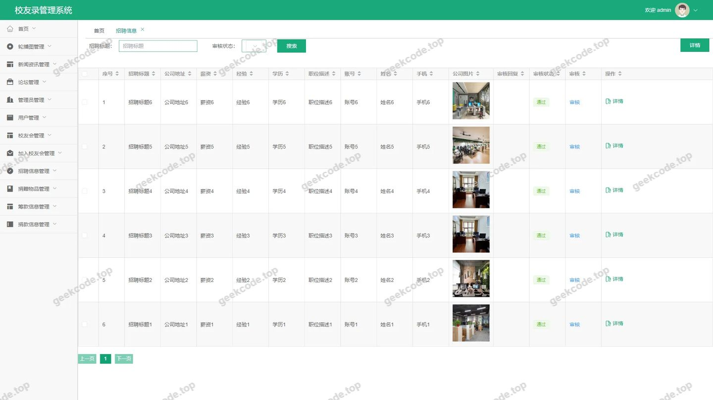

# [springboot]校友录管理系统

> 🎓 **计算机毕业设计 · [springboot]校友录管理系统**
>
> 本仓库只放**项目介绍 + 运行截图**（截图是站点带水印的原图，存在仓库 `images/` 里）。
>
> 👉 **完整可运行源码 / 数据库脚本 / 部署文档：[点我获取](https://geekcode.top/archives/springboot-%E6%A0%A1%E5%8F%8B%E5%BD%95%E7%AE%A1%E7%90%86%E7%B3%BB%E7%BB%9F?utm_source=github)**
>
> 💬 咨询微信：**ir9372**　|　🌐 更多项目：[极客代码 geekcode.top](https://geekcode.top/?utm_source=github)
>
> 📌 项目详情页：<https://geekcode.top/archives/springboot-%E6%A0%A1%E5%8F%8B%E5%BD%95%E7%AE%A1%E7%90%86%E7%B3%BB%E7%BB%9F?utm_source=github>

<table><td width="230" align="center"> <b>扫码加微信 ir9372</b></td><td valign="middle">📦 源码 = 项目介绍 + 全部运行截图 + 数据库 + 部署文档 👉 点上方任意截图，直接跳到 <b>极客代码 geekcode.top</b> 详情页</td></table>

---

<h1>[springboot]校友录管理系统</h1>
<h2>项目概述</h2>

本项目为“校友录管理系统”，旨在构建一个集信息展示、互动交流与资源管理于一体的综合性校友服务平台。系统采用前后端分离架构，面向广大校友及管理员提供差异化服务。核心功能涵盖新闻资讯发布、招聘信息对接、校友会组织管理、捐赠物品与捐款信息记录以及用户个人中心维护等模块。通过整合 MyBatis-Plus 数据持久层框架与 Apache Shiro 安全认证机制，系统实现了高效的数据交互与严格的安全控制。适用人群包括需要寻找工作机会或分享资源的普通校友用户，以及负责内容审核、用户管理及数据维护的系统管理员。该项目有效解决了传统校友联络中信息分散、沟通效率低及资源匹配难的问题，提升了校友社群的活跃度与管理规范性。

<h2>技术架构</h2>

本系统基于 Spring Boot 框架构建后端服务，利用其自动配置特性简化开发流程，集成 <code>spring-boot-starter-web</code> 提供 RESTful API 接口支持。数据持久层采用 MyBatis-Plus 结合 <code>mysql-connector-java</code>，通过 ORM 映射实现数据库的高效操作，并引入 <code>mybatis-spring-boot-starter</code> 确保框架间的无缝协作。安全权限体系基于 Apache Shiro (<code>shiro-spring</code>)，实现用户身份认证与授权访问控制，保障系统数据安全。前端界面采用 Vue.js 技术栈（依据 vue-integrated 类型推断），通过路由管理实现页面跳转与状态保持。数据库设计遵循规范化原则，主要表结构涵盖用户信息、新闻公告、招聘详情、校友会成员、捐赠记录及财务信息等实体，各表之间通过外键关联，确保数据的一致性与完整性。

<h2>功能模块</h2>
<h3>前台用户端</h3>
<ol>
<li><strong>首页与信息浏览</strong>：展示最新新闻资讯列表，提供快速入口访问各类核心板块。</li>
<li><strong>用户中心</strong>：支持用户注册、登录，查看个人信息详情，编辑个人资料及添加新用户记录。</li>
<li><strong>校友会管理</strong>：浏览校友会列表，查看校友会详情，申请加入校友会，以及新增校友会记录。</li>
<li><strong>招聘服务</strong>：查看招聘信息列表，检索特定职位详情，发布新的招聘信息。</li>
<li><strong>互动交流</strong>：访问论坛列表，参与话题讨论与信息交换。</li>
<li><strong>公益捐赠</strong>：查看捐赠物品列表及详情，发起物品捐赠；查看捐款信息列表及详情，录入捐款记录。</li>
</ol>
<h3>后台管理端</h3>
<ol>
<li><strong>系统配置</strong>：管理系统基础参数配置。</li>
<li><strong>用户管理</strong>：对注册用户进行增删改查操作，维护用户账号状态。</li>
<li><strong>内容管理</strong>：<ul>
<li><strong>新闻资讯</strong>：发布、编辑、删除及查询新闻文章。</li>
<li><strong>论坛管理</strong>：监控论坛帖子，处理违规内容。</li>
<li><strong>招聘信息</strong>：审核与管理发布的职位信息。</li>
</ul>
</li>
<li><strong>组织与成员管理</strong>：<ul>
<li><strong>校友会</strong>：创建、修改及删除校友会组织信息。</li>
<li><strong>加入申请</strong>：审核校友提交的加入校友会申请。</li>
</ul>
</li>
<li><strong>财务与物资管理</strong>：<ul>
<li><strong>捐赠物品</strong>：记录与管理校友捐赠的实物资产。</li>
<li><strong>捐款信息</strong>：登记、统计及管理校友的资金捐赠明细。</li>
<li><strong>筹款信息</strong>：管理筹款活动及相关数据。</li>
</ul>
</li>
</ol>
<h2>用户角色与权限</h2>

根据代码上下文中的路由配置及 Shiro 安全框架的应用，系统主要划分为以下两类角色：

<table>
<thead>
<tr>
<th align="left">角色名称</th>
<th align="left">描述</th>
<th align="left">可访问功能模块</th>
</tr>
</thead>
<tbody><tr>
<td align="left"><strong>普通用户 (校友)</strong></td>
<td align="left">系统的终端使用者，主要用于浏览信息、发布内容及维护个人档案。</td>
<td align="left">1. 前台所有路由：- <code>/index/newsList</code>, <code>/index/yonghuList</code>, <code>/index/yonghuDetail</code>, <code>/index/yonghuAdd</code>, <code>/index/yonghuCenter</code>- <code>/index/xiaoyouhuiList</code>, <code>/index/xiaoyouhuiDetail</code>, <code>/index/xiaoyouhuiAdd</code>- <code>/index/jiaruxiaoyouhuiList</code>, <code>/index/jiaruxiaoyouhuiDetail</code>, <code>/index/jiaruxiaoyouhuiAdd</code>- <code>/index/zhaopinxinxiList</code>, <code>/index/zhaopinxinxiDetail</code>, <code>/index/zhaopinxinxiAdd</code>- <code>/index/forumList</code>- <code>/index/juanzengwupinList</code>, <code>/index/juanzengwupinDetail</code>, <code>/index/juanzengwupinAdd</code>- <code>/index/choukuanxinxiList</code>, <code>/index/choukuanxinxiDetail</code>, <code>/index/choukuanxinxiAdd</code>- <code>/index/juankuanxinxiList</code>, <code>/index/juankuanxinxiDetail</code>, <code>/index/juankuanxinxiAdd</code>- <code>/yonghuRegister</code></td>
</tr>
<tr>
<td align="left"><strong>管理员</strong></td>
<td align="left">系统运营与维护人员，拥有最高权限，负责全局数据管理与内容审核。</td>
<td align="left">1. 后台所有路由：- <code>/news</code> (新闻资讯管理)- <code>/forum</code> (论坛管理)- <code>/zhaopinxinxi</code> (招聘信息管理)- <code>/juanzengwupin</code> (捐赠物品管理)- <code>/yonghu</code> (用户管理)- <code>/juankuanxinxi</code> (捐款信息管理)- <code>/jiaruxiaoyouhui</code> (加入校友会审核)- <code>/config</code> (系统配置)- <code>/xiaoyouhui</code> (校友会管理)- <code>/users</code> (系统账户管理)- <code>/choukuanxinxi</code> (筹款信息管理)2. 后台登录页及首页概览。</td>
</tr>
</tbody></table>
<h2>项目特色与创新点</h2>
<ol>
<li><strong>全流程数字化管理</strong>：系统覆盖了从校友入驻、信息交流到公益捐赠的全生命周期管理，打破了传统校友录仅作为静态通讯录的局限，实现了动态化的社群运营。</li>
<li><strong>多维度的资源整合</strong>：创新性地将招聘求职、物品捐赠、资金筹集等多种资源类型纳入同一平台，通过分类路由（如 <code>/zhaopinxinxi</code>, <code>/juanzengwupin</code>, <code>/juankuanxinxi</code>）实现精准匹配，提高了校友间互助的效率。</li>
<li><strong>严谨的安全认证机制</strong>：引入 Apache Shiro 框架，针对前后台不同路径实施细粒度的权限控制，确保普通用户无法越权访问后台管理接口，保障了校友隐私数据及财务信息的安全性。</li>
<li><strong>模块化前端架构</strong>：采用 Vue 集成方案，将复杂的业务逻辑拆解为独立的路由组件（如 <code>yonghuCenter</code>, <code>xiaoyouhuiDetail</code>），提升了页面的加载速度与用户体验的流畅度，便于后续功能的扩展与维护。</li>
</ol>
<h2>部署环境</h2>

为确保“校友录管理系统”正常运行，需准备以下软件环境：

<ol>
<li><strong>Java 运行环境</strong>：JDK 1.8 或以上版本（推荐 JDK 8 LTS）。</li>
<li><strong>数据库服务</strong>：MySQL 5.7 或 MySQL 8.0，需初始化相关表结构以支持 MyBatis-Plus 操作。</li>
<li><strong>Web 服务器</strong>：内置 Tomcat（由 Spring Boot Starter Web 提供）或独立的 Nginx/Apache 用于反向代理。</li>
<li><strong>前端构建工具</strong>：Node.js (建议 v14+) 和 npm/yarn，用于编译 Vue 前端代码。</li>
<li><strong>开发辅助工具</strong>：Maven (用于依赖管理) 和 Git (用于版本控制)。</li>
</ol>
<h2>五、技术特性</h2>
<ul>
<li>前后端集成部署，前端资源打包至后端 static 目录</li>
<li>使用 MyBatis-Plus 简化数据访问层开发</li>
<li>集成 Shiro 权限框架实现角色权限控制</li>
</ul>
<h2>六、功能模块截图</h2>
<h3>前台用户端</h3>
<h4>前台-登录</h4>

<h4>前台-用户注册</h4>

<h3>后台管理端</h3>
<h4>后台-登录页</h4>

<h4>后台-加入校友会</h4>

<h4>后台-捐款信息</h4>

<h4>后台-捐赠物品</h4>

<h4>页面-首页</h4>

<h4>后台-新闻资讯</h4>

<h4>后台-用户</h4>

<h4>后台-招聘信息</h4>

---

## 获取完整源码

| 项目 | 说明 |
| --- | --- |
| 项目名 | [springboot]校友录管理系统 |
| 运行截图 | 本文 10 张（站点带水印原图，仓库 `images/` 目录） |
| 完整源码 | [https://geekcode.top/archives/springboot-%E6%A0%A1%E5%8F%8B%E5%BD%95%E7%AE%A1%E7%90%86%E7%B3%BB%E7%BB%9F?utm_source=github](https://geekcode.top/archives/springboot-%E6%A0%A1%E5%8F%8B%E5%BD%95%E7%AE%A1%E7%90%86%E7%B3%BB%E7%BB%9F?utm_source=github) |
| 咨询微信 | **ir9372**（备注：jingpin-yuanma） |
| 更多项目 | [极客代码 geekcode.top](https://geekcode.top/?utm_source=github) |

> 需要源码、部署、改配置、跑不起来等问题，加微信 ir9372 沟通，说明项目名即可。
